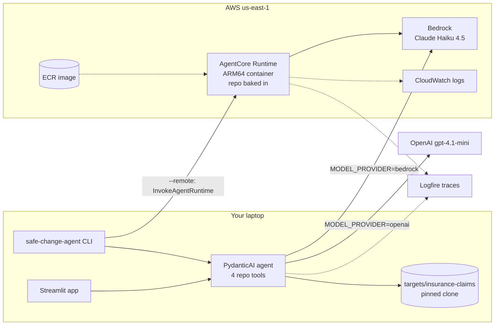

# Safe Change Agent

An agent that helps engineers understand an unfamiliar AWS serverless codebase before they change it. It investigates the code, the CDK infrastructure and the docs with tools, answers with `file:line` citations, rejects questions built on false premises, and declines anything that isn't about the repo. It runs locally against OpenAI or Amazon Bedrock, and is deployed on **Amazon Bedrock AgentCore Runtime** with Claude Haiku 4.5.

Capstone project for the [AI Engineering Buildcamp](https://maven.com/alexey-grigorev/from-rag-to-agents) (Cohort 4).

## The problem

I work on a large serverless insurance system (Lambda, EventBridge, SQS, DynamoDB, CDK). Every spike in an unfamiliar part of it takes 1–2 days, mostly spent rebuilding domain knowledge from old code, outdated Confluence/Miro pages and Slack threads. Changes to shared models (one big DynamoDB policy object) break downstream Lambdas, because nobody has a map of what reads or writes each field.

Copilot and Claude Code read the files. They don't know the wiring: which EventBridge rule routes `Claim.Accepted` to which Lambda lives in CDK, not in the handler code. That wiring is what this agent is being built to understand.

## What it does today

```
$ safe-change-agent --remote "Who listens for ClaimAccepted?"

The Notifications Service listens for ClaimAccepted events.

1. Event rule (lib/claims-processing-stack.ts:110-127): the NotificationsService is
   configured with an EventBridge rule that includes ClaimsEvents.CLAIM_ACCEPTED
   (lib/claims-processing-stack.ts:118), defined as "Claim.Accepted" in
   lib/services/claims/infra/claims-events.ts:4.
2. Handler (lib/services/notifications/app/handlers/notifications.js): receives the
   event (line 14), looks up the customer's user subject (lines 18-24) and publishes
   it to AppSync Events on /notifications/{userSub} (lines 52-104).

[remote bedrock:us.anthropic.claude-haiku-4-5-20251001-v1:0: 7 tool calls,
 46793 in / 957 out tokens, 8.7s, session so far $0.0516]
```

- **Four read-only tools:** `list_files`, `search_code`, `read_file`, `search_docs`. Missing paths return an error, never an empty list (the agent once accepted a made-up "payment service" because of that).
- **Cited answers.** Every claim points at `path:line`; the code is the source of truth when docs disagree.
- **False premises rejected.** "Which Kafka topics…", "how does the payment service…", "why SageMaker…": it checks, then says what doesn't exist and what does.
- **Scope.** Off-topic requests (poems, React tutorials, other clouds) are declined; the agent never reveals its instructions.
- **Three ways to run it:** CLI, Streamlit chat with 👍/👎 feedback, and `--remote` against the AgentCore deployment.
- **Monitoring:** Logfire traces for every run (tool calls, tokens, cost), plus a usage report.
- **Evaluation:** 55 hand-written scenarios with labels, an LLM judge measured against them, and a replay harness for the deployed agent. Numbers below.

### Where it's going (by 7 Dec)

A parser over the synthesised CloudFormation (`cdk.out`) that builds the real graph: rules → targets, queues → functions, who may read or write which table. On top of it: a **spike brief** for any function, event or table; an **impact diff** for a change (which consumers, queues and tables it touches); a **change plan with human approval**; and the same tools exposed over **MCP** so Copilot and Claude Code can call them. The project card is in [docs/project-card.md](docs/project-card.md).

## Architecture



The same `create_agent()` serves all three paths. `src/safe_change_agent/runtime.py` wraps it in the AgentCore HTTP contract (`POST /invocations`, `GET /ping`, port 8080); the container copies the pinned target repo in so the deployed agent has something to read.

## Target repo

The agent is built and evaluated on a public AWS sample that looks like the system I work on, cloned at a pinned commit by `make targets`:

- [serverless-eda-insurance-claims-processing](https://github.com/aws-samples/serverless-eda-insurance-claims-processing): event-driven insurance claims with EventBridge, SQS, Step Functions, DynamoDB, API Gateway, Cognito, Bedrock and EventCatalog docs. (Stretch: [generative-ai-use-cases](https://github.com/aws-samples/generative-ai-use-cases), `./scripts/fetch_targets.sh --stretch`.)

## Setup

Requirements: [uv](https://docs.astral.sh/uv/getting-started/installation/), git, and for the deploy, Docker plus an AWS account.

```bash
git clone https://github.com/mahmoudchebbani/safe-change-agent.git
cd safe-change-agent
cp .env.example .env        # then edit: MODEL_PROVIDER, keys, model ids
make setup                  # uv sync --all-extras
make targets                # clones the target repo at the pinned commit into targets/
make test                   # unit tests; LLM tests skip without keys
```

`.env` chooses the model:

| `MODEL_PROVIDER` | Needs | Model |
|---|---|---|
| `openai` (default) | `OPENAI_API_KEY` | `OPENAI_MODEL`, default `gpt-4.1-mini` |
| `bedrock` | AWS credentials (`AWS_PROFILE` / env vars) with Bedrock access | `BEDROCK_MODEL`, default `us.anthropic.claude-haiku-4-5-20251001-v1:0` |

For Bedrock on a new AWS account: in the console, Bedrock → Model access → submit the Anthropic use-case form once, then enable Claude Haiku 4.5. Claude Sonnet 4.5 is marked "legacy" on new accounts and is refused.

## Run it

```bash
uv run safe-change-agent "What consumes the Fraud.Detected event?"   # terminal, interactive after the first question
uv run streamlit run app.py                                           # chat app with 👍/👎 feedback
uv run safe-change-agent --remote "Who listens for ClaimAccepted?"    # the deployed agent (after make deploy)
```

Set `LOGFIRE_TOKEN` in `.env` to get one trace per session with every agent run, LLM call, tool call, token count, cost and feedback. `uv run python scripts/usage_report.py` summarises them per conversation.

## Deploy to Bedrock AgentCore

```bash
make docker-build                       # ARM64 image, ~1 GB (AgentCore's limit is 2 GB)
make docker-run                         # run it locally with your AWS credentials mounted read-only
make invoke-local Q="Which Kafka topics does the claims service publish to?"

make deploy                             # ECR repo → build + push → execution role → create/update runtime → wait READY
make invoke Q="Who listens for ClaimAccepted?"
```

`make deploy` runs [scripts/deploy_agentcore.py](scripts/deploy_agentcore.py). It is idempotent: rerun it after a code change and it pushes a new image and a new runtime version. It writes the runtime ARN to `.agentcore.json` (gitignored), which `--remote` and `make invoke` read. The execution role gets exactly the permissions from the [AgentCore runtime permissions doc](https://docs.aws.amazon.com/bedrock-agentcore/latest/devguide/runtime-permissions.html): pull the image, write logs and traces, invoke Bedrock.

Things that bit me:

- A freshly created role takes ~30 s before AgentCore's ECR check sees its policy; the script retries.
- Any `BEDROCK_MODEL` in your `.env` is passed to the runtime; keep it on an enabled model.
- The first request in a new session pays a 13–17 s cold start (microVM plus image pull); later requests take 2–10 s.
- The Streamlit dependencies alone are ~300 MB, so the image installs the project without the `ui` extra.

Logs land in CloudWatch under `/aws/bedrock-agentcore/runtimes/safe_change_agent-*`. Tear down with `aws bedrock-agentcore-control delete-agent-runtime --agent-runtime-id <id>` and delete the ECR repo; the runtime costs nothing while idle.

## Tests

```bash
make test                                              # 11 unit tests (tools, cost, config); LLM tests skip without keys
MODEL_PROVIDER=bedrock uv run pytest tests/test_agent.py   # 3 agent tests: false premise, off-topic, no instruction leak
uv run pytest tests/test_judge.py                      # 3 LLM-judge tests (OpenAI), one xfail until list_endpoints exists
```

CI (`.github/workflows/ci.yml`) runs the unit tests and builds the ARM64 image on every push.

## Evaluation

Details and datasets in [eval/README.md](eval/README.md).

- **55 scenarios** (`eval/scenarios.csv`): 16 happy path, 12 rephrasings, 12 edge cases, 9 false premises, 6 off-topic. Run with `eval/run_scenarios.py`; labelled good/bad with a failure category in `eval/label_app.py`.
- **First run** (gpt-4.1-mini): **12/55 bad**. Incomplete answers 8 (stops at the first file, trusts the README over the code), wrong scope 3, instruction leak 1. False premises: 9/9 rejected. Rephrasings: 12/12 fine. $0.91 for the 55.
- **LLM judge** vs my labels (bad = positive class): v1 accuracy 0.836, precision 0.80, recall 0.33; v2 (more lenient rules) accuracy 0.80, precision 1.00, recall 0.08. The judge can't tell an answer is incomplete without seeing the repo, so v3 gives it the read-only tools.
- **After the scope fixes, on the deployed agent** (Haiku 4.5, `eval/run_scenarios.py --remote`): the 6 off-topic and 9 false-premise scenarios replayed; the 4 that were bad are fixed, the 11 that were good held. $0.14.
- **Model choice:** Haiku 4.5 on Bedrock vs gpt-4.1-mini on the same 5 scenarios: equal or better answers, 2–5× faster, 4–10× the cost per question (it reads more files). `eval/results_bedrock_haiku45_smoke5.json`.

## Cost

| What | Cost |
|---|---|
| One question, gpt-4.1-mini | ≈ $0.02 average, $0.10 worst case (35 tool calls) |
| One question, Haiku 4.5 on Bedrock | $0.003 (declined) to $0.08 (10+ files read) |
| AgentCore Runtime | billed per vCPU-second while a session is active; idle costs nothing |
| Full 55-scenario eval | ≈ $0.90 (gpt-4.1-mini), ≈ $2.50 (Haiku 4.5) |

Input tokens dominate (≈ 50k per question in a chat with history). Capping tool calls, deduplicating identical calls and trimming history are the next cost items.

## Project structure

```
src/safe_change_agent/   config (provider switch), data (repo loading, doc index), tools, agent,
                         cost, monitoring, cli, remote (AgentCore client), runtime (AgentCore entrypoint)
app.py                   Streamlit chat
tests/                   unit tests, agent tests, judge tests
eval/                    scenarios, results, labels, judge versions, replay runner
scripts/                 fetch_targets.sh, deploy_agentcore.py, invoke_agentcore.py, usage_report.py
notebooks/               02-rag (week 1 RAG baseline), 03-agent (week 2 first agent)
docs/                    project card
Dockerfile, Makefile, .github/workflows/ci.yml
```
